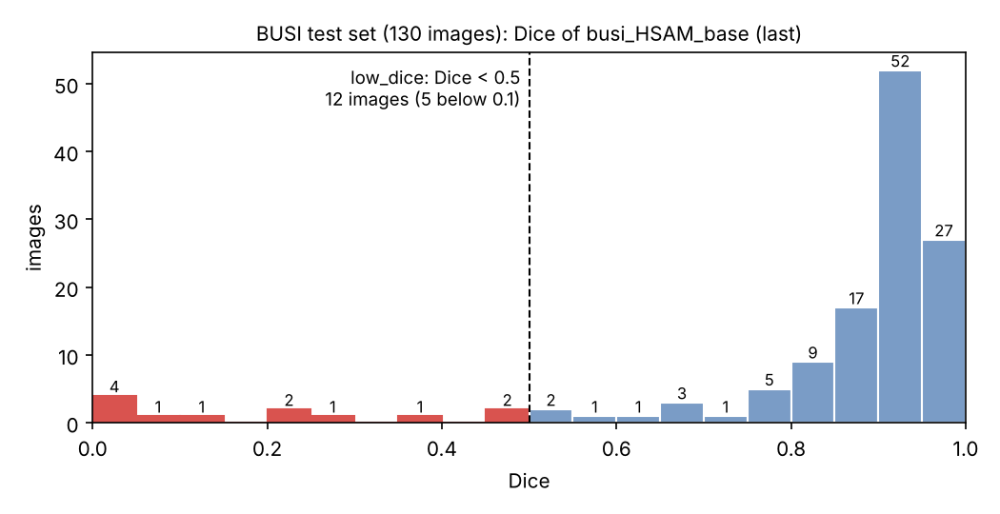
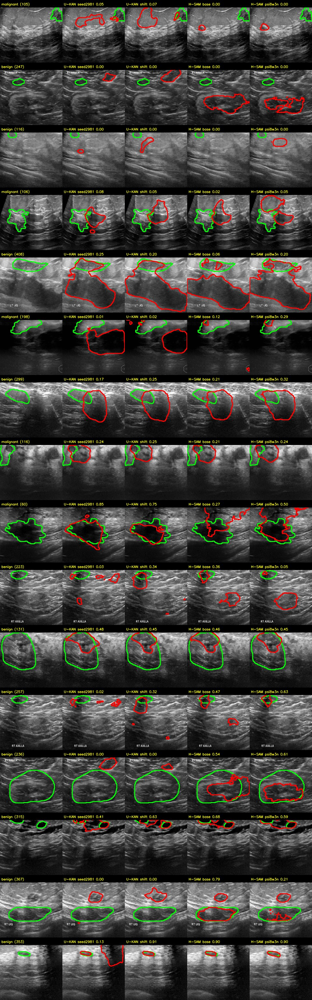

# Ψ-weighted H-SAM：BUSI

**BUSI 的 Ψ 加權實驗分成兩個模型：[psi-weighted-ukan](https://github.com/OwenWu930302/psi-weighted-ukan)（U-KAN）｜psi-weighted-hsam（H-SAM，本倉庫）**
討論用的追加實驗（資料增強、Dropout、失敗診斷）：[psi-discussion/busi](https://github.com/OwenWu930302/psi-discussion/tree/main/busi)

在 SAM 類模型上重做 [psi-weighted-ukan](https://github.com/OwenWu930302/psi-weighted-ukan)（U-KAN）的 Ψ 加權實驗：
baseline 的訓練集預測算出 Ψ，取 Ψ 最明顯的影像 loss × 3（÷ n），比較對照組與專家。分析一律用最後一個 epoch（last）。

**結論**
1. H-SAM 的 baseline 比 U-KAN 好：同樣在 256×256 計算，測試集 Dice 0.829（U-KAN base2 0.782）。
2. Ψ 在 H-SAM 上抓困難影像的能力比在 U-KAN 上好：訓練集三個 Ψ 都顯著（Ψ8 AUC 0.84），測試集 Ψ8 抓到全部 12 張低分影像。
3. 但 Ψ 加權沒有提升整體：三個專家相對對照組 −0.003 到 −0.005（Ψ8 p = 0.047，方向是下降）。
4. Ψ8 專家在低分 12 張上 +0.058（8 張升、1 張降，p = 0.012），但被誤挑的 40 張正常影像略降，整體抵銷。
5. H-SAM 的 12 張低分影像中有 11 張也是 U-KAN 的低分影像；`benign (247)`、`benign (116)` 在所有模型都是 0。困難的是影像本身，不是特定模型。
6. **8 個模型（U-KAN 3 個、H-SAM 5 個）全部 Dice < 0.1 的有 3 張：`benign (247)`、`benign (116)`、`malignant (106)`**（`malignant (105)` 8 個中 7 個 < 0.1）。全部 < 0.5 的有 10 張（第 6 節）。
7. 教授的 failure_diagnostics.py：H-SAM baseline 的 12 張失敗 = 6 張 delineation + 6 張 missed，沒有 wrong-choice；梯度對齊與 U-KAN **相反**：Ψ8 加權清單與失敗影像同方向（rho_G +0.41，隨機對照 −0.24，12 張中 11 張 A > 0），與 Ψ8 專家在低分影像上 +0.058 一致（第 7 節）。

## 模型與公平性

| 項目 | 內容 |
|---|---|
| 模型 | **H-SAM**：Cheng et al., *Unleashing the Potential of SAM for Medical Adaptation via Hierarchical Decoding*, CVPR 2024（[論文](https://arxiv.org/abs/2403.18271)、[程式](https://github.com/Cccccczh404/H-SAM)，MIT，commit `5bdf491`） |
| 預訓練權重 | SAM ViT-B（`sam_vit_b_01ec64.pth`，只用自然影像預訓練，沒有看過 BUSI） |
| prompt | **不用任何 prompt**（點、框、遮罩皆為 `None`，訓練與測試相同）。標註只用在 loss，不進入模型計算 |
| 切分 | 與 U-KAN 相同：`train_test_split(test_size=0.2, random_state=2981)`，訓練 517 / 測試 130 |
| 設定 | 官方 README 的單一類別（PROMISE12）指令：ViT-B、512×512、LoRA rank 5、AdamW、warmup、lr 0.0026、dice 0.9、250 epoch、batch 8 × n_gpu 2 = 16、seed 2345 |
| 評估 | 官方推論（stage 3 = 兩個 decoder 平均），逐張 Dice 在原始解析度計算；另存 `dice256`（縮到 256×256，與 U-KAN 相同）只用來和 U-KAN 比較 |

為什麼選 H-SAM：同行審查（CVPR 2024）、原作者設計就不用 prompt、從公開 SAM 權重開始。
SAMUS / AutoSAMUS（MICCAI 2024）雖有 BUSI 設定，但 AutoSAMUS 要先載入以 point prompt 訓練的 SAMUS，作者提供的 SAMUS 權重又是用包含 BUSI（不同切分）的 US30K 訓練，可能看過測試影像，所以不採用。

**與官方不同的地方**（修改處皆標註，不給選項時與原版相同）

| 項目 | 原因 | 程式 |
|---|---|---|
| `--dataset Synapse` | 官方 README 的 PROMISE12 指令寫 `PROMISE`，但官方 `train.py` 只接受 `Synapse`（只是程式內的名稱） | — |
| 測試時直接縮到 512 | 官方 `test.py` 的 `input_size` 預設 224 是給 Synapse 的；BUSI 訓練時由原圖直接縮到 512 | [predict_hsam.py](hsam_extension/predict_hsam.py) |
| 梯度累積 `--accum 2` `[梯度累積]` | RTX 4080（16 GB）放不下 batch 16：同一個 batch 16 分 2 份 forward / backward 後更新一次，batch、迭代次數、學習率不變。只有 baseline 的 Dice（官方為整批計算）與第二個 decoder 的隨機雜訊強度改為每份各自計算 | [patch_hsam_accum.py](hsam_extension/patch_hsam_accum.py) |
| 逐張 loss `[Ψ加權]` | 官方 Dice 是整個 batch 一起算，無法逐張加權；改成逐張計算 L = (1/n) Σ w_i · L_i。即使權重全為 1 也和官方不同，所以另有對照組 | [patch_hsam_weighted.py](hsam_extension/patch_hsam_weighted.py) |

## 模型

| 模型 | loss | 加權清單 |
|---|---|---|
| `busi_HSAM_base` | 官方（batch Dice） | — |
| `busi_HSAM_ctrl`（對照組） | 逐張，權重全為 1 | — |
| `busi_HSAM_psi1w3n` | 逐張，清單 × 3、÷ n | Ψ1 凸包比，155 張 |
| `busi_HSAM_psi6w3n` | 同上 | Ψ6 連通元件，64 張 |
| `busi_HSAM_psi8w3n` | 同上 | Ψ8 旋轉一致性，155 張 |

## 1. 每個模型的分數 — [models_BUSI.csv](results/analysis/models_BUSI.csv)

| 模型 | 測試集 130 | 其他 118 | 低分 12 | U-KAN 低分 15 | 那 9 張 | 訓練集 517 | 差距 | 測試集（256×256） |
|---|---|---|---|---|---|---|---|---|
| base | **0.8295** | 0.8953 | 0.1817 | 0.3221 | 0.2554 | 0.9042 | 0.075 | 0.8292 |
| ctrl | 0.8280 | 0.8950 | 0.1698 | 0.2671 | 0.1585 | 0.9267 | 0.099 | 0.8281 |
| psi1w3n | 0.8246 | 0.8892 | 0.1897 | 0.3316 | 0.2591 | 0.9222 | 0.098 | 0.8244 |
| psi6w3n | 0.8231 | 0.8890 | 0.1751 | 0.2522 | 0.1236 | 0.9188 | 0.096 | 0.8228 |
| psi8w3n | 0.8230 | 0.8834 | **0.2282** | 0.3027 | 0.2036 | 0.9223 | 0.099 | 0.8233 |

- 低分 12 = baseline（`busi_HSAM_base`）測試集 Dice < 0.5（`low_dice`，第 4 節）；其他 118 = 測試集其餘。
- U-KAN 低分 15、那 9 張：psi-weighted-ukan 的定義（U-KAN `seed2981` Dice < 0.5；`moved_busi_dice02.csv`）。差距 = 訓練集 − 測試集。
- 對照 U-KAN（256×256）：base2 0.782、加平移增強 0.818（[psi-discussion](https://github.com/OwenWu930302/psi-discussion/tree/main/busi)）。

**成對比較（逐張 Wilcoxon）** — [models_BUSI_compare.csv](results/analysis/models_BUSI_compare.csv)

| 比較 | 測試集 130 | p | 低分 12 | p |
|---|---|---|---|---|
| base → ctrl（逐張 loss 本身） | −0.0014 | 0.29 | −0.0119 | 0.91 |
| ctrl → psi1w3n | −0.0034 | 0.29 | +0.0200 | 0.43 |
| ctrl → psi6w3n | −0.0050 | 0.52 | +0.0053 | 0.92 |
| ctrl → psi8w3n | −0.0051 | 0.047 | **+0.0584** | **0.012** |
| base → psi8w3n | −0.0065 | 0.50 | +0.0465 | 0.16 |

## 2. Ψ 篩選與加權清單 — [weight_lists/](weight_lists/)

用 baseline 對訓練集 517 張的預測算 Ψ（不看標註），與 baseline 的訓練集 Dice 比較；低分組 = Dice ≤ 0.9067（後 30%，155 張）。規則同 psi-weighted-ukan（[screen_hsam.py](hsam_extension/screen_hsam.py)）。

| Ψ | AUC | p | 規則 | 清單 |
|---|---|---|---|---|
| Ψ1 凸包比 | 0.792 | 9.3e-26 | 前 30%（≥ 1.06001） | 155 |
| Ψ6 連通元件 | 0.561 | 1.5e-4 | > 0 | 64 |
| Ψ8 旋轉一致性 | 0.838 | 3.0e-34 | 前 30%（≥ 0.0594595） | 155 |
| Ψ7 拓撲環 | 0.487 | 0.38 | 不顯著 | — |

H-SAM 沒有把訓練集背起來（訓練集 Dice 0.90，U-KAN 0.97），所以 Ψ 在訓練集上分得出好壞。

## 3. 訓練集：被加權的影像有沒有變好 — [weighted_cases_BUSI_summary.csv](results/analysis/weighted_cases_BUSI_summary.csv)

| 專家 | 加權張數 | 加權影像 ctrl → 專家 | 升 / 降 | 未加權影像 Δ | 加權 − 未加權 |
|---|---|---|---|---|---|
| Ψ1 | 155 | 0.9027 → 0.9123（+0.0096） | 110 / 45 | −0.0106 | +0.020 |
| Ψ6 | 64 | 0.8971 → 0.9268（+0.0297） | 52 / 12 | −0.0133 | +0.043 |
| Ψ8 | 155 | 0.8928 → 0.9037（+0.0109） | 98 / 57 | −0.0110 | +0.022 |

全部 p < 0.001。與 U-KAN 相同：×3 讓清單上的影像擬合得更好，其他訓練影像略降。逐張：[weighted_cases_BUSI.csv](results/analysis/weighted_cases_BUSI.csv)、[weighted_cases_BUSI_all.csv](results/analysis/weighted_cases_BUSI_all.csv)、[weighted_cases_BUSI_compare.csv](results/analysis/weighted_cases_BUSI_compare.csv)。

## 4. 測試集：Ψ 挑到的影像 vs 真正低分的影像



- **low_dice**：baseline（`busi_HSAM_base`）測試集 Dice < 0.5，12 張（5 張 < 0.1）。由 baseline 定義，與對照組 ctrl 是不同模型。
- **prominent**：baseline 的 Ψ 超過訓練清單的門檻（不看標註）。hit = prominent 且 low_dice；false_pick = prominent 但不是 low_dice。

**(a) Ψ 挑了幾張、挑到幾張低分** — [test_BUSI_selection.csv](results/analysis/test_BUSI_selection.csv)

| 專家 | 門檻 | prominent | hit | false_pick | missed | coverage | precision |
|---|---|---|---|---|---|---|---|
| Ψ1 | ≥ 1.06001 | 41 | 9 | 32 | 3 | 9/12 = 0.75 | 9/41 = 0.22 |
| Ψ6 | > 0 | 24 | 7 | 17 | 5 | 7/12 = 0.58 | 7/24 = 0.29 |
| Ψ8 | ≥ 0.0594595 | 52 | 12 | 40 | 0 | **12/12 = 1.00** | 12/52 = 0.23 |

**(b) 對照組 ctrl → 專家，Δ（升 / 降）** — [test_BUSI_summary.csv](results/analysis/test_BUSI_summary.csv)

| 專家 | all（130） | prominent | low_dice（12） | false_pick |
|---|---|---|---|---|
| Ψ1 | −0.0034（60 / 67） | +0.0088（18 / 22） | +0.0200（6 / 3） | +0.0052（13 / 19） |
| Ψ6 | −0.0050（61 / 67） | −0.0265（11 / 12） | +0.0053（6 / 4） | −0.0261（8 / 9） |
| Ψ8 | −0.0051（55 / 72），p = 0.047 | +0.0079（26 / 23） | **+0.0584（8 / 1），p = 0.012** | −0.0073（18 / 22） |

- Ψ8 在低分影像上有改善，但挑到的 52 張中 40 張原本就不差，這些影像略降，整個測試集反而 −0.005。
- 共 12 個比較，p = 0.012 未經多重比較校正，只能視為方向。逐張：[test_BUSI_percase.csv](results/analysis/test_BUSI_percase.csv)。

## 5. 低分影像 — [low_dice_BUSI_wide.csv](results/analysis/low_dice_BUSI_wide.csv)

H-SAM 的 12 張低分與 U-KAN 的 15 張低分，每個模型的 Dice（[low_dice_BUSI_summary.csv](results/analysis/low_dice_BUSI_summary.csv) 為各組平均）：

| 組別 | 張數 | U-KAN seed2981 | base | ctrl | psi1w3n | psi6w3n | psi8w3n |
|---|---|---|---|---|---|---|---|
| H-SAM 低分 | 12 | 0.182 | 0.182 | 0.170 | 0.190 | 0.175 | 0.228 |
| 兩個模型都低分 | 11 | 0.122 | 0.174 | 0.142 | 0.200 | 0.179 | 0.203 |
| 只有 H-SAM 低分 | 1 | 0.849 | 0.265 | 0.479 | 0.078 | 0.133 | 0.502 |
| 只有 U-KAN 低分 | 4 | 0.134 | 0.729 | 0.612 | 0.694 | 0.454 | 0.576 |
| 那 9 張 | 9 | 0.021 | 0.255 | 0.159 | 0.259 | 0.124 | 0.204 |

- 12 張中 11 張也是 U-KAN 的低分；只有 `malignant (60)` 是 H-SAM 獨有（U-KAN 0.85）。
- U-KAN 低分但 H-SAM 正常的 4 張：`benign (353)` 0.90、`benign (367)` 0.79、`benign (315)` 0.68、`benign (236)` 0.54。
- `benign (247)`、`benign (116)` 在 U-KAN 與 5 個 H-SAM 模型都是 0；那 9 張 H-SAM 平均 0.26，比 U-KAN（0.02）好，但仍遠低於其他影像。

## 6. 疊合圖：哪些影像真的太難 — [hard_cases_BUSI.csv](results/analysis/hard_cases_BUSI.csv)

上面 16 張低分影像（H-SAM 或 U-KAN 低分），U-KAN 3 個模型（seed2981 best、base2、shift）與 H-SAM 5 個模型的預測。
全部縮到 256×256 計算 Dice（H-SAM 的數字因此與第 5 節略有差異）。程式：[overlay_hsam_ukan.py](hsam_extension/overlay_hsam_ukan.py)。



一覽圖每列一張影像：原圖、U-KAN seed2981、U-KAN shift、H-SAM base、H-SAM psi8w3n（綠 = 標註、紅 = 預測、黃字 = Dice）。
每張影像 8 個模型的完整圖在 [results/examples/low_dice/](results/examples/low_dice/)（上列：原圖、標註、U-KAN 三個；下列：H-SAM 五個）。

| 組別 | 影像 | 8 個模型的 Dice | 圖上看到的 |
|---|---|---|---|
| **全部 < 0.1（真的太難）** | `benign (247)`、`benign (116)`、`malignant (106)`、`malignant (105)`（7 / 8） | 0.00–0.20 | 腫瘤很小或貼在影像邊緣（116、105），或旁邊有更明顯的暗區（106、247）；兩種架構都沒找到，各自圈了別的地方 |
| **全部 < 0.5，錯法一樣** | `benign (299)`、`malignant (116)`、`benign (131)`、`benign (408)` | 0.06–0.48 | 所有模型的輪廓幾乎相同：圈到相鄰的暗區或聲影（299、116、408），或只圈上半部（131）。可能是標註對範圍的認定，需要醫師確認 |
| **全部 < 0.5，錯法不同** | `malignant (198)`、`benign (223)` | 0.00–0.36 | U-KAN 圈到大片暗區，H-SAM 只圈到一部分 |
| **H-SAM 較好** | `benign (367)`、`benign (236)`、`benign (257)` | U-KAN 0.00–0.32；H-SAM 最高 0.63–0.79 | U-KAN 圈到旁邊的暗區或沒有預測；H-SAM 找到腫瘤，但不同 H-SAM 模型之間差很多（例：367 為 0.00–0.79） |
| **只有 U-KAN seed2981 低分** | `benign (353)`、`benign (315)` | 其他 7 個模型 0.58–0.93 | 偶發：seed2981 多圈了旁邊的區塊 |
| **U-KAN 做得到，H-SAM 做不到** | `malignant (60)` | U-KAN 0.75–0.85；H-SAM 0.08–0.50 | H-SAM 沿著上方邊緣多圈了一長條 |

## 7. 教授的失敗診斷 — [results/diagnostics/](results/diagnostics/)

教授的 [failure_diagnostics.py](https://github.com/OwenWu930302/psi-discussion/blob/main/busi/code/failure_diagnostics.py)（未修改，自我測試 10 項 PASS：[selftest.txt](results/diagnostics/selftest.txt)），作法同 [psi-discussion 第 8 節](https://github.com/OwenWu930302/psi-discussion/tree/main/busi)。
輸入由 [diag_npz_hsam.py](hsam_extension/diag_npz_hsam.py) 產生：測試集 130 張的機率圖（H-SAM 推論，縮到 256×256）、Ψ1 / Ψ6 / Ψ8（baseline 的預測）、梯度；執行：[run_diag_hsam.sh](hsam_extension/run_diag_hsam.sh)。
Ψ 門檻 = 加權清單的最小值（程式用「>」，所以減 1e-7）；Ψ6 為 > 0。

**7.1 候選區域與失敗類型**（機率 > 0.2 的區塊依最高機率排名，蓋到 ≥ 30% 標註才算命中）

| 模型 | 失敗（Dice < 0.5） | delineation | wrong-choice | missed | recall@1 | recall@5 |
|---|---|---|---|---|---|---|
| base | 12 / 130 | 6 | 0 | 6 | 0.50 | 0.50 |
| ctrl | 14 / 130 | 9 | 1 | 4 | 0.64 | 0.71 |
| psi1w3n | 13 / 130 | 7 | 1 | 5 | 0.54 | 0.62 |
| psi6w3n | 14 / 130 | 7 | 2 | 5 | 0.50 | 0.64 |
| psi8w3n | 13 / 130 | 7 | 2 | 4 | 0.54 | 0.69 |

- baseline 與 U-KAN 一樣沒有 wrong-choice；missed 6 張（U-KAN seed2981 為 9 張）。逐張加權後的模型出現 1–2 張 wrong-choice，看前幾名候選可多救回這幾張。
- baseline 的 6 張 missed：`benign (247)`、`benign (116)`、`malignant (105)`、`malignant (106)`、`malignant (198)`、`benign (408)`，其中前 3 張標註內的最高機率 < 0.06（完全沒當成腫瘤）。

**7.2 Ψ 偵測失敗的能力**（baseline）

| Ψ | AUROC（95% CI） | 抓到的失敗 | 誤報率 | precision | 標記張數 |
|---|---|---|---|---|---|
| Ψ1 凸包比 | —（`benign (116)` 沒有任何預測，Ψ1 無法計算） | 0.75 | 0.27 | 0.22 | 41 |
| Ψ6 連通元件 | 0.71（0.52–0.89） | 0.58 | 0.14 | 0.29 | 24 |
| Ψ8 旋轉一致性 | **0.92（0.84–0.97）** | **1.00** | 0.34 | 0.23 | 52 |

形狀特徵（Ψ1、Ψ6）合起來抓到 83% 的失敗；兩者都沒標到的 85 張中只剩 2 張失敗，在這群裡 Ψ8 的 AUROC 是 0.98。

**7.3 梯度對齊**（baseline；參數 = 兩個 decoder 中產生遮罩的 hypernetwork MLP 最後一層，24,672 維；loss = 最後一個 epoch 的官方 loss）

| 測試影像 | 訓練影像 | rho_G | A > 0 |
|---|---|---|---|
| 12 張失敗 | Ψ8 加權清單 155 張（× 3） | **+0.41** | 11 / 12 |
| 　其中 6 張 missed | 同上 | +0.54 | 6 / 6 |
| 　其中 6 張 delineation | 同上 | +0.29 | 5 / 6 |
| 12 張失敗 | 隨機 155 張（對照） | −0.24 | |
| 118 張非失敗 | Ψ8 加權清單 | +0.10 | 77 / 118 |

- **與 U-KAN 相反**（U-KAN：失敗 −0.40、對照 −0.18）：在 H-SAM 上，Ψ8 清單的梯度與失敗影像同方向，而且明顯高於隨機對照，代表 Ψ8 挑到的訓練影像與測試失敗「相關」。這和 Ψ8 專家在低分 12 張上 +0.058（第 4 節）一致。
- 但同方向只是一階近似：`benign (247)`、`benign (116)`、`malignant (105)` 在 Ψ8 專家仍是 0；加權的改善也被 40 張誤挑的正常影像抵銷。
- 參數與 loss 都和 U-KAN 不同，兩個模型只比較正負，不比較大小。

## 資料夾

| 路徑 | 內容 |
|---|---|
| [hsam_extension/](hsam_extension/) | 資料轉換、兩個 patch、預測與 Ψ、篩選、記憶體測試、訓練腳本、整理（collect_hsam.py）、分析（analyze_hsam.py）、失敗診斷（diag_npz_hsam.py、run_diag_hsam.sh）、疊合圖（overlay_hsam_ukan.py） |
| [results/percase/](results/percase/) | 每個模型逐張結果（訓練集 + 測試集）：`dice`（原始解析度）、`dice256`、Ψ1–Ψ10（base 才有 Ψ） |
| [results/training_logs/](results/training_logs/) | 官方 trainer 的逐迭代紀錄（`_log.txt`）與設定（`_config.txt`） |
| [results/analysis/](results/analysis/) | 上面各節的表格與圖；檔名、欄位與 psi-weighted-ukan 的 `results/analysis/` 相同（`checkpoint` 皆為 last）；`hard_cases_BUSI.csv` 為第 6 節 |
| [results/examples/](results/examples/) | 第 6 節的疊合圖：`low_dice_overview.jpg`（一覽）、`low_dice/`（每張影像 8 個模型） |
| [results/diagnostics/](results/diagnostics/) | 第 7 節：每個模型的 `per_case.csv`、`summary.json`（教授程式的輸出），`selftest.txt` |
| [weight_lists/](weight_lists/) | Ψ 篩選結果（`proxy_selection_busi.csv`）與三份加權清單 |

## 重現

```
git clone https://github.com/Cccccczh404/H-SAM.git && cd H-SAM && git checkout 5bdf491
# 放入 hsam_extension/ 的檔案，下載 SAM ViT-B 權重到 checkpoints/
python patch_hsam_weighted.py && python patch_hsam_accum.py
python prep_busi_hsam.py <U-KAN inputs/busi> ../data/busi
nohup bash run_hsam_busi.sh > run_hsam_busi.log 2>&1 &          # 5 個模型，RTX 4080 約 15 小時
python collect_hsam.py --base .. --repo <本倉庫> --masks <inputs/busi/masks/0>
python hsam_extension/analyze_hsam.py --ukan_repo ../psi-weighted-ukan   # 在本倉庫根目錄
bash run_diag_hsam.sh > run_diag_hsam.log 2>&1   # H-SAM 資料夾：失敗診斷 + 疊合圖（需 psi-discussion 的 failure_diagnostics.py、name_cases.py）
```

環境：Python 3.10、torch 2.2.0 + cu118、官方 requirements（不含 mmcv 等未使用的套件）。
